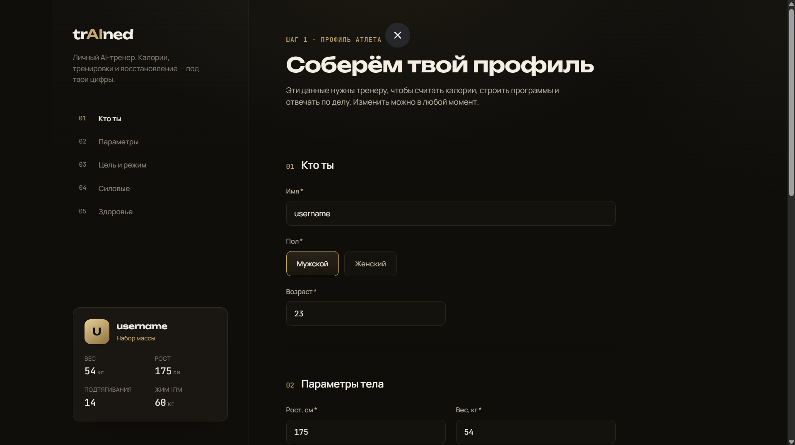
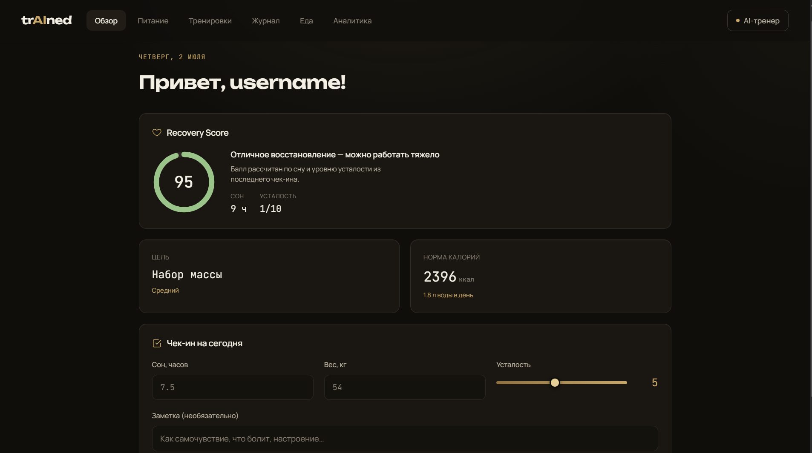
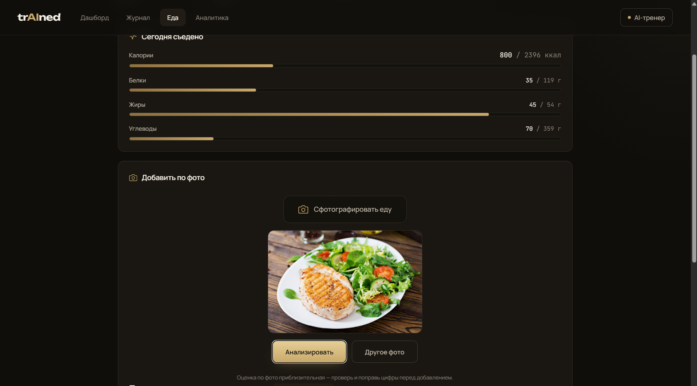
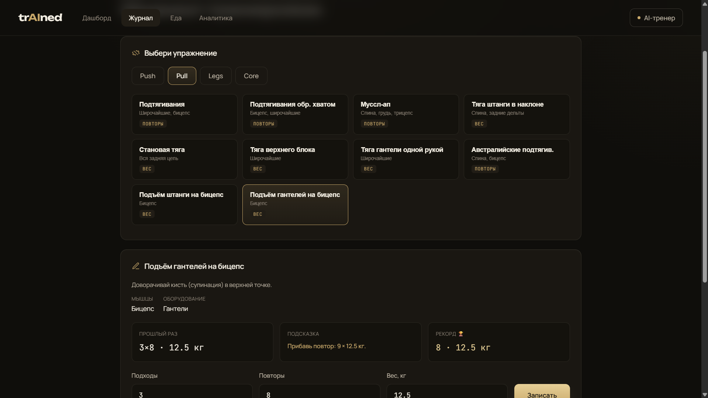
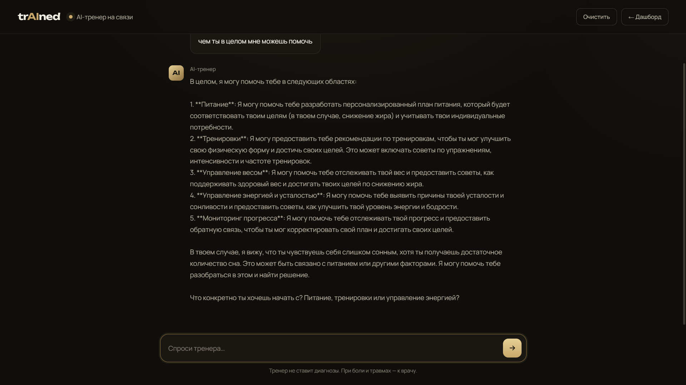
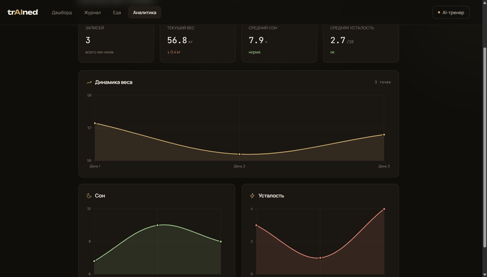
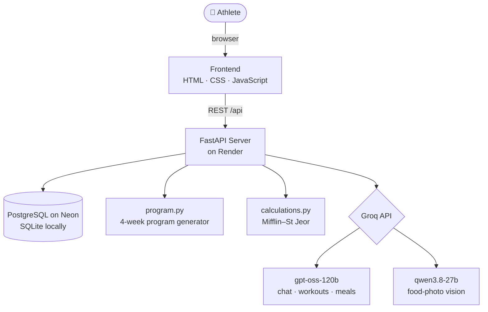

<div align="center">

# 🏋️ trAIned

### Your personal AI fitness & nutrition coach

Get a full training program in one minute, scan your meals, and get advice tuned to *your* numbers — powered by AI.


**[🌐 Live app](https://trained.onrender.com)** · interface in Russian

</div>

---

## 📖 About

**trAIned** is a full-stack web app that works as a personal fitness coach. Anyone can create an account, answer a few questions, and immediately get a **complete 4-week training program** built for their level — from total beginner to competitive athlete. It calculates calorie and macro targets, adapts each workout to how recovered you are, tracks strength progress with progressive-overload suggestions, and — its standout feature — **estimates the calories and macros of a meal from a single photo**, including regional Central Asian dishes like beshbarmak, plov, and manty.

I built it as an athlete who wanted one tool that actually understood my own training data instead of generic advice.

---

## ✨ Features

| Module | What it does |
| --- | --- |
| **🔐 Accounts** | Registration and login with strong password rules, PBKDF2 password hashing, 30-day sessions, brute-force protection, password change and "log out on all devices". |
| **🧭 Onboarding** | Collects your profile: age, height, weight, goal, activity level, experience (beginner → pro), training days per week, available equipment, injuries, and strength stats. |
| **📅 Training Program** | Right after onboarding builds a full 4-week program. Picks the split from days per week, exercises from your equipment, skips exercises that load an injured joint, calculates working weights from your 1RM, and ends each cycle with a deload week. Shows which session is next. |
| **🍽️ Smart Nutrition** | Calculates daily calories & macros (Mifflin–St Jeor) and generates a full day's meal plan with AI. |
| **📸 Food Diary (photo & text)** | Snap a photo of your meal — a vision model estimates calories & macros — or simply describe it in words ("beshbarmak, large plate ~400 g"). Estimates are editable before saving, and daily intake is tracked against your targets. Recognizes local Central Asian dishes. |
| **💪 Smart Training** | AI coach adapts the planned workout to your sleep & fatigue, plus a library of **55 exercises** filterable by equipment (bodyweight / dumbbells / gym / bands) with difficulty levels, step-by-step technique guides & common mistakes, set logging, **progressive-overload suggestions**, and **personal records**. |
| **💬 AI Coach Chat** | Full-screen chat that knows your profile, latest check-in, weekly stats, and nutrition plan. Conversation history is persisted. |
| **🔋 Recovery Score** | A 0–100 readiness score derived from your sleep and fatigue check-ins. |
| **📊 Analytics** | Progress charts for body weight, sleep, and fatigue over time. |
| **💾 Backups & usage stats** | One command backs up the whole database and builds a usage report: users, active users, workouts, sets, meals — week by week. |

---

## 🖼️ Screenshots

| Onboarding | Dashboard |
| --- | --- |
|  |  |

| Photo Food Diary | Workout Log |
| --- | --- |
|  |  |

| AI Coach | Analytics |
| --- | --- |
|  |  |

---

## 📅 How the training program is built

The program generator (`backend/program.py`) is rule-based, not an LLM — the same profile always gets the same, explainable plan.

| Step | Logic |
| --- | --- |
| **Split** | 2–3 days → full body · 4 → upper/lower · 5 → upper/lower + push/pull/legs · 6 → push/pull/legs ×2. Beginners get max 4 lifting days, extra days become active recovery. |
| **Exercises** | Chosen by movement pattern (squat, hinge, push, pull…), filtered by equipment, level and injuries. Pull-up variations depend on your max reps. |
| **Sets & reps** | From goal (muscle gain, fat loss, recomposition, maintenance, endurance) and level. Advanced users rotate heavy / medium / volume days. |
| **Weights** | From your bench-press 1RM with the Epley formula: `1RM / (1 + (reps + reps in reserve) / 30)`. |
| **Progression** | Beginner — linear · Intermediate — double progression · Advanced — block (3 + 1) · Pro — daily undulating. Week 4 is always a deload. |

---

## 🏗️ Architecture

A multi-user app: a vanilla JS frontend talks to a FastAPI backend over a REST API. The backend handles the math and program generation itself, stores everything in PostgreSQL (SQLite for local development), and calls the Groq API for anything that needs intelligence.



---

## 🛠️ Tech Stack

- **Backend:** Python, FastAPI, Uvicorn
- **Database:** PostgreSQL (Neon) in production, SQLite locally — the same code, chosen by `DATABASE_URL`
- **AI:** Groq API — `openai/gpt-oss-120b` (text) and `qwen/qwen3.8-27b` (vision), configurable through environment variables
- **Frontend:** Vanilla HTML / CSS / JavaScript (no framework), Chart.js for graphs
- **Design:** Custom dark design system (shared `style.css`), Google Fonts (Unbounded, Manrope, JetBrains Mono)
- **Hosting:** Render (app) + Neon (database)

---

## 📂 Project Structure

```
trAIned/
├── backend/
│   ├── __init__.py
│   ├── main.py            # FastAPI server: auth, all endpoints, serves the frontend
│   ├── database.py        # PostgreSQL / SQLite connection, schema & auto-migrations
│   ├── program.py         # 4-week training program generator
│   ├── calculations.py    # Calorie & macro math (Mifflin–St Jeor)
│   ├── ai_coach.py        # Groq calls: chat, workout adaptation, meal plans, food-photo vision
│   ├── exercises.py       # Exercise library (55 exercises: equipment, levels, technique) + progression logic
│   └── stats.py           # Usage statistics & backup export
├── frontend/
│   ├── style.css          # Shared design system
│   ├── app.js             # Shared helpers (API wrappers, auth, account dialog, labels)
│   ├── login.html         # Sign in / register
│   ├── index.html         # Onboarding
│   ├── dashboard.html     # Dashboard (overview / nutrition / training)
│   ├── plan.html          # 4-week training program
│   ├── workout.html       # Workout log: equipment filter, technique guides, progression & PRs
│   ├── food.html          # Food diary (photo & text analysis)
│   ├── chat.html          # Full-screen AI coach
│   └── analytics.html     # Progress charts
├── scripts/
│   └── backup.py          # Database backup to CSV + usage report
├── docs/                  # Screenshots for this README
├── .env.example           # Template for your environment variables
├── .gitignore
├── requirements.txt
└── README.md
```

---

## 🚀 Getting Started

### Prerequisites

- Python 3.10 or newer
- A free [Groq API key](https://console.groq.com/keys)

### Installation

```bash
# 1. Clone the repository
git clone https://github.com/YOUR_USERNAME/trAIned.git
cd trAIned

# 2. (Recommended) create a virtual environment
python -m venv venv
# Windows:
venv\Scripts\activate
# macOS / Linux:
source venv/bin/activate

# 3. Install dependencies
pip install -r requirements.txt

# 4. Add your Groq API key
#    Copy the example file and paste your key inside
cp .env.example .env          # Windows: copy .env.example .env
#    then edit .env -> GROQ_API_KEY=your_key_here

# 5. Run the server
uvicorn backend.main:app --reload
```

Open **http://127.0.0.1:8000** in your browser.

> **Windows note:** if `python` / `pip` / `uvicorn` aren't recognized, prefix them with the Python launcher:
> `py -m pip install -r requirements.txt` and `py -m uvicorn backend.main:app --reload`.

Without `DATABASE_URL` a local SQLite database (`trained.db`) is created automatically on first run.

### Environment Variables

| Variable | Description |
| --- | --- |
| `GROQ_API_KEY` | Your Groq API key (required). Kept in `.env`, which is git-ignored. |
| `DATABASE_URL` | PostgreSQL connection string (optional). Empty → local SQLite. |
| `ADMIN_TOKEN` | Long random string (optional). Enables the usage report and backup download at `/api/admin/*`. |
| `GROQ_TEXT_MODEL` / `GROQ_VISION_MODEL` | Override the AI models (optional) — useful when Groq retires a model. |

---

## 💾 Backups & Usage Statistics

```bash
python scripts/backup.py --db "postgresql://..."
```

Reads the database (read-only) and saves `backups/<date>/`: one CSV per table, `stats.json`, and `report.html` — registered and active users, returning users, workout sessions, sets, total volume lifted, meals, and weekly growth. Password hashes and session tokens are never exported.

On the deployed app the same report is available at `/api/admin/report?key=ADMIN_TOKEN`, and a zip backup at `/api/admin/backup?key=ADMIN_TOKEN`.

---

## 🔌 API Reference

Interactive docs are available at **`/docs`** (Swagger UI) once the server is running. All endpoints except auth need an `Authorization: Bearer <token>` header.

<details>
<summary><b>Auth</b></summary>

| Method | Endpoint | Description |
| --- | --- | --- |
| `POST` | `/api/auth/register` | Create an account |
| `POST` | `/api/auth/login` | Log in, returns a session token |
| `POST` | `/api/auth/logout` | Log out of this device |
| `POST` | `/api/auth/logout-all` | Log out of all devices |
| `POST` | `/api/auth/change-password` | Change password |
| `GET` | `/api/auth/me` | Current user |

</details>

<details>
<summary><b>Profile</b></summary>

| Method | Endpoint | Description |
| --- | --- | --- |
| `POST` | `/api/profile` | Save the athlete profile, returns the nutrition plan and builds the training program |
| `GET` | `/api/profile` | Get the current profile |

</details>

<details>
<summary><b>Nutrition</b></summary>

| Method | Endpoint | Description |
| --- | --- | --- |
| `GET` | `/api/nutrition/plan` | Calorie & macro targets |
| `POST` | `/api/nutrition/meal-plan` | AI-generated meal plan |
| `POST` | `/api/nutrition/analyze-photo` | Estimate calories/macros from a food photo |
| `POST` | `/api/nutrition/analyze-text` | Estimate calories/macros from a text description |
| `GET` | `/api/nutrition/today` | Today's intake vs. target + meal list |
| `POST` | `/api/nutrition/log` | Add a meal to the diary |
| `DELETE` | `/api/nutrition/log/{id}` | Remove a meal |

</details>

<details>
<summary><b>Training</b></summary>

| Method | Endpoint | Description |
| --- | --- | --- |
| `GET` | `/api/training/plan` | Current 4-week program + next session |
| `POST` | `/api/training/plan` | Rebuild the program with new days / equipment / level |
| `POST` | `/api/training/workout` | Today's planned session adapted to recovery by the AI coach |
| `POST` | `/api/training/log` | Daily check-in (sleep, fatigue, weight) |
| `GET` | `/api/training/logs` | Check-in history |
| `GET` | `/api/exercises` | Exercise library |
| `POST` | `/api/training/exercise-log` | Log a set; flags new personal records |
| `GET` | `/api/training/exercise-logs` | Logged sets history |
| `GET` | `/api/training/records` | Personal records per exercise |
| `GET` | `/api/training/progression/{exercise_id}` | Last set + overload suggestion |

</details>

<details>
<summary><b>Recovery & Chat</b></summary>

| Method | Endpoint | Description |
| --- | --- | --- |
| `GET` | `/api/recovery` | Recovery score (0–100) |
| `POST` | `/api/chat` | Ask the AI coach |
| `GET` | `/api/chat/history` | Chat history |
| `DELETE` | `/api/chat/history` | Clear chat |

</details>

<details>
<summary><b>Admin</b></summary>

| Method | Endpoint | Description |
| --- | --- | --- |
| `GET` | `/api/stats` | Public totals |
| `GET` | `/api/admin/stats` | Full usage statistics (JSON) |
| `GET` | `/api/admin/report` | Usage report page with charts |
| `GET` | `/api/admin/backup` | Zip backup of all tables |

</details>

---

## 🗄️ Database Schema

PostgreSQL (SQLite locally), nine tables. New columns and tables are added automatically on startup, so an existing database upgrades without manual migrations.

- **`users`** — accounts (username, password hash)
- **`sessions`** — login sessions (hashed tokens)
- **`profile`** — athlete data
- **`training_plan`** — generated 4-week programs
- **`training_log`** — daily check-ins (sleep, fatigue, weight)
- **`workout_log`** — logged exercises (sets, reps, weight)
- **`nutrition_log`** — logged meals (calories, macros)
- **`chat_history`** — AI conversation history
- **`user_visits`** — one row per user per day, for active-user statistics

---

## 🧗 Challenges & what I learned

- **No backup, no numbers.** The first deployed version kept everything only in the live database: no backups, and no way to tell how many people actually used the app or how many workouts they logged. I added a backup script and a usage report (all tables to CSV + weekly stats), plus daily visit tracking, so the data is safe and the impact is measurable.
- **AI models disappear.** Groq retired both models the app was built on (Llama 3.3 and Llama 4 Scout), and food recognition and the chat stopped working overnight. I moved to the current models, made them configurable through environment variables, and added automatic fallback to a backup model.
- **From one user to many.** The app started as a single-user tool on SQLite. Moving it online meant accounts, per-user data, PostgreSQL, and proper security — stronger password rules, slower password hashing, expiring sessions, and limits on login attempts.
- **Generic AI workouts weren't enough.** Asking an LLM for "a workout for today" gave random sessions with no progression. I replaced it with a rule-based program generator based on real training principles, and kept the AI only for adapting the planned session to recovery.

---

## 🗺️ Roadmap

- [x] Multi-user accounts (registration & login)
- [x] Deploy to the web
- [x] Personal 4-week training programs for every level
- [x] Database backups & usage statistics
- [ ] Per-exercise progression charts
- [ ] Profile editing screen
- [ ] Training streaks & consistency tracking
- [ ] Body-measurement tracking (chest, arms, waist)
- [ ] Export progress to a PDF report
- [ ] English interface
- [ ] Installable mobile app (PWA)

---

## ⚠️ Disclaimer

trAIned is a personal project and **not** medical or professional dietary advice. Photo-based calorie estimates are approximate. Consult a qualified professional for medical, injury, or nutrition concerns.

---

## 📄 License

Released under the MIT License.

---

<div align="center">

Built with ❤️ and a lot of pull-ups.

</div>
